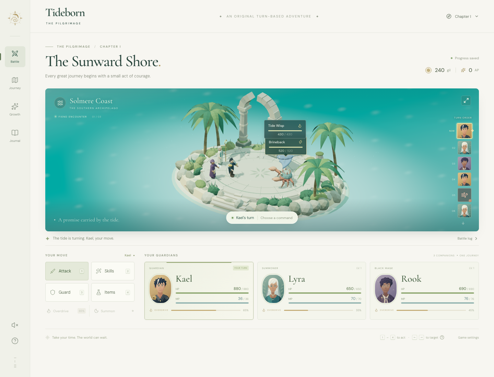

# Tideborn — The Pilgrimage

An original browser RPG inspired by Final Fantasy X’s conditional turn-based battles, party roles, overdrives, summoning, and progression grid. A complete three-encounter vertical slice with its own characters, world, procedural 3D art, portraits, and soundscape.

Lead **Kael**, **Lyra**, and **Rook** from Solmere Coast through the Verdant Ruins to the Temple of the Tides. Choose your moves, exploit elemental weaknesses, protect your companions, and confront the Hollow Warden.



## Play locally

Requires Node.js 22.12+ (Node.js 24 recommended).

```sh
npm ci
npm run dev
```

Open the local URL printed by Vite. For the production version:

```sh
npm run build
npm run preview
```

The production output is a self-contained static site in `dist/`. It needs no backend, credentials, external image services, or runtime font requests. Serve it with an HTTP server rather than opening `index.html` as a file.

## How to play

- **Attack** (`1`): hit the selected enemy. Click its nameplate or model to change target; left/right arrows cycle targets.
- **Skills** (`2`): Kael delays enemies or attacks the whole field; Lyra heals or casts light magic; Rook uses lightning, fire, and ice. The symbol on each enemy marks its weakness.
- **Guard** (`3`): reduce incoming damage by 60% until that guardian’s next action.
- **Items** (`4`): potions restore 400 HP, ethers restore 35 MP, and Phoenix Feathers revive an ally with half their HP.
- **Overdrive**: acting and taking damage build the gauge. At 100%, unleash a character-specific special.
- **Summon**: once per encounter, on Lyra’s turn, call Auralis for a powerful attack on every enemy.
- **Growth**: earn AP from victories and unlock each hero’s Vitality, Strength, and Radiance nodes in order.

The timeline previews upcoming turns assuming normal attacks; skills, guarding, and delay effects can change it. Enemies act automatically. There is no timer on your decisions.

Clear each encounter to earn AP and gil. Traveling restores 30% HP and 25 MP and adds a potion. Losing a battle offers a fully restored retry that preserves earned progression. Clear the third encounter to see the ending. Gil is a victory score in this slice; there is no shop.

Progress automatically saves to this browser’s local storage after every completed action. If storage is unavailable, the game remains playable for the current session. The sound button enables an original procedural ambient chord and combat effects. Game settings offer a confirmed fresh start. `Esc` closes dialogs and command menus.

## What is included

- Three original heroes with seven unique abilities and three overdrives.
- Three deterministic, winnable encounters with a final boss and an ending.
- A procedural Three.js island, animated ocean and characters, target selection, damage numbers, spell effects, and a summoned sea spirit.
- Original SVG portraits, a journey map, story journal, battle record, and nine unlockable progression nodes.
- Responsive desktop/mobile layouts, keyboard controls, accessible dialogs, reduced-motion support, and a functional combat fallback if WebGL is unavailable.

This is a compact battle-focused homage, not a recreation of the commercial game’s full story, exploration, assets, or music. All characters and setting details here are original.

## Verification

```sh
npm test
npm run build
npx playwright install chromium
npm run test:e2e
npm run format:check
```

Unit tests cover combat scheduling, elemental damage, resources, healing/revival, guard, summons, overdrives, progression, defeat recovery, save validation, and a complete campaign. Browser tests use the production build to exercise real controls, saved progress, mobile layout, and a full three-chapter playthrough. Playwright owns a temporary preview server on port 5195.

## Project structure

| File                 | Responsibility                                                  |
| -------------------- | --------------------------------------------------------------- |
| `src/game.ts`        | Serializable deterministic game state and combat rules          |
| `src/scene.ts`       | Procedural 3D scene, targeting, animation, and resource cleanup |
| `src/App.tsx`        | Battle interface, dialogs, progression, and local persistence   |
| `src/audio.ts`       | Opt-in original Web Audio soundscape and effects                |
| `src/styles.css`     | Responsive parchment-and-sea visual design                      |
| `src/game.test.ts`   | Combat and campaign regression tests                            |
| `tests/game.spec.ts` | Production browser integration tests                            |
| `public/portraits/`  | Original vector character portraits                             |

Built with React, TypeScript, Vite, Three.js, and Lucide. DM Sans and Cormorant Garamond are bundled through Fontsource. Project code and original art use the [MIT license](LICENSE); bundled dependencies and fonts retain their respective licenses.
